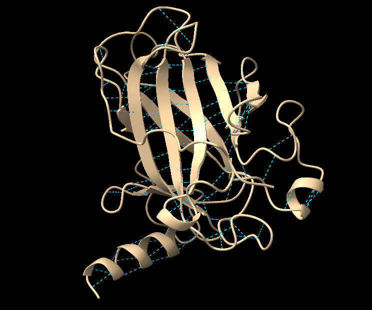
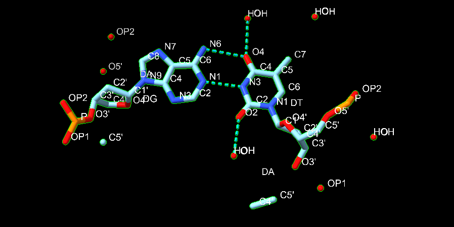
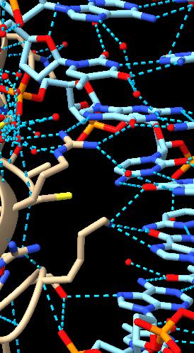

# Scientist’s Mission(0123B008 黃昱翔)

[GitHub README](https://github.com/nonosay/0123B008/blob/main/README.md)

## Who Stole TP53’s Superpower? Searching for the Key to Unlock Cancer

### Using AI to Uncover the Secrets of TP53–DNA Interactions

## 1. 【The LEGO Assembly Line】

What type of bond links amino acids together to form a protein? Which amino acids form hydrogen bonds with each other?

**Answer: Peptide bonds (covalent bonds)**

Serine (Ser) and asparagine (Asn) can form hydrogen bond

## 2. 【The Double-Track Highway of Life’s Blueprint】

How do nucleotides assemble to form double-stranded DNA? What are the basic structural components of DNA? Is DNA right-handed or left-handed? List the names of the four DNA bases. Which bases form hydrogen bonds with each other?

**Answer:**

### 1. How do nucleotides assemble to form double-stranded DNA?

Nucleotides are linked by phosphodiester bonds to form two antiparallel   strands. The strands are held together by hydrogen bonds between complementary bases, forming a double helix.

### 2. What are the basic structural components of DNA?

Each DNA nucleotide consists of three components:

- A phosphate group

- A deoxyribose sugar

- A nitrogenous base

### 3. Is DNA right-handed or left-handed?

DNA is typically right-handed (B-DNA). However, Z-DNA is left-handed.

### 4. List the names of the four DNA bases.

- Adenine (A)

- Thymine (T)

- Guanine (G)

- Cytosine (C)

### 5. Which bases form hydrogen bonds with each other?

- Adenine (A) – Thymine (T): 2 hydrogen bonds

- Guanine (G) – Cytosine (C): 3 hydrogen bonds

## 3. 【Searching for My One-and-Only Soulmate in the Universe: A 20-Base-Pair Love Code Hidden Among 3 Billion DNA Base Pairs】

The source of molecular stability and specificity: hydrogen bonding — How do TP53 and DNA recognize each other?

Using the structure 3KMD, identify one pair of an amino acid and a DNA base that interact with each other.

**Answer:**

Arginine (Arg280) in TP53 interacts with Guanine (G) in DNA through hydrogen bonds.

This interaction helps TP53 recognize and bind specific DNA sequences.

## 4. 【Return to the Crime Scene】

Why can a mutation (change) in just one amino acid of a protein sometimes lead to a serious human disease? Give one specific example of such a disease.

**Answer:**

A mutation in just one amino acid can change a protein’s 3D structure, stability, or function, potentially causing serious disease.

Example: Li-Fraumeni syndrome (TP53 mutation)

A mutation such as R175H replaces arginine (Arg) with histidine (His) at position 175 of the p53 protein. This disrupts its structure and tumor-suppressing function, increasing the risk of developing cancer.

## 5. 【Return to the Crime Scene: Searching for Clues】

Using the TP53–DNA structure (3KMD), identify one TP53 amino acid mutation that can lead to uncontrolled cell division and contribute to the development of cancer.

Then examine this amino acid in ChimeraX. Based on its three-dimensional position, determine whether the mutated amino acid is located directly at the protein–DNA interface or somewhere else in the protein.

**Answer:**

The R175H mutation replaces arginine (Arg) with histidine (His) at amino acid position 175 of TP53.

In the 3D structure, Arg175 is not directly at the protein–DNA interface. It is located in the L2 loop, near the zinc-binding region of the protein.

This mutation disrupts the protein's structural stability, reducing its ability to bind DNA and suppress uncontrolled cell division, which can contribute to cancer.

a. Paste a screenshot of your ChimeraX visualization here.

b. Save your ChimeraX session file as StudentID.cxs.
